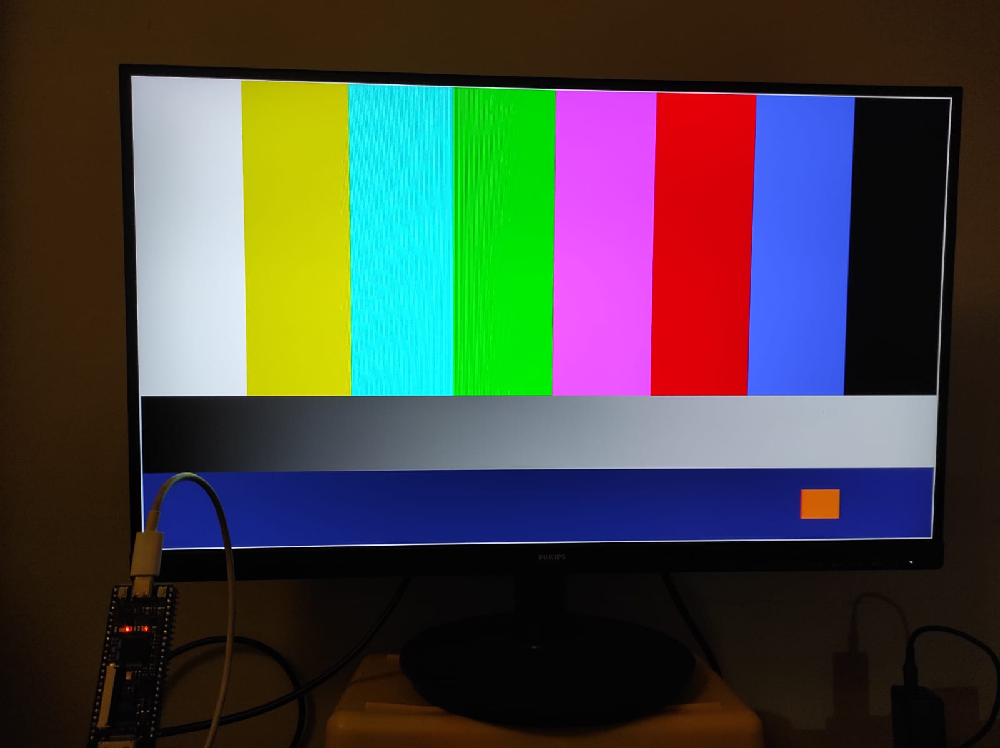
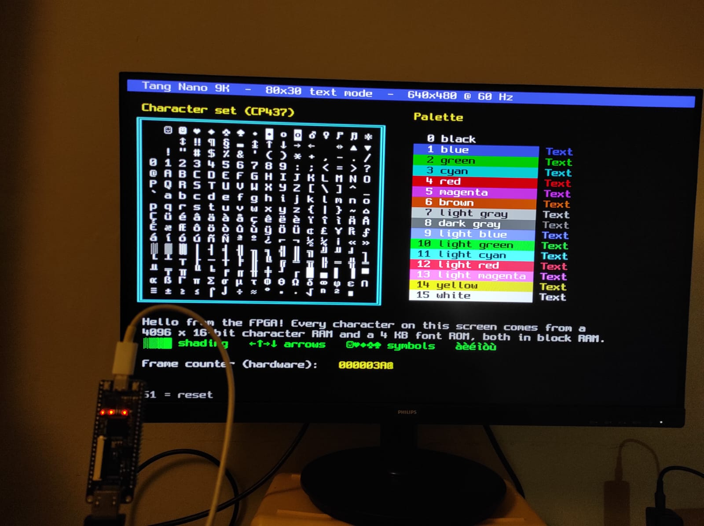
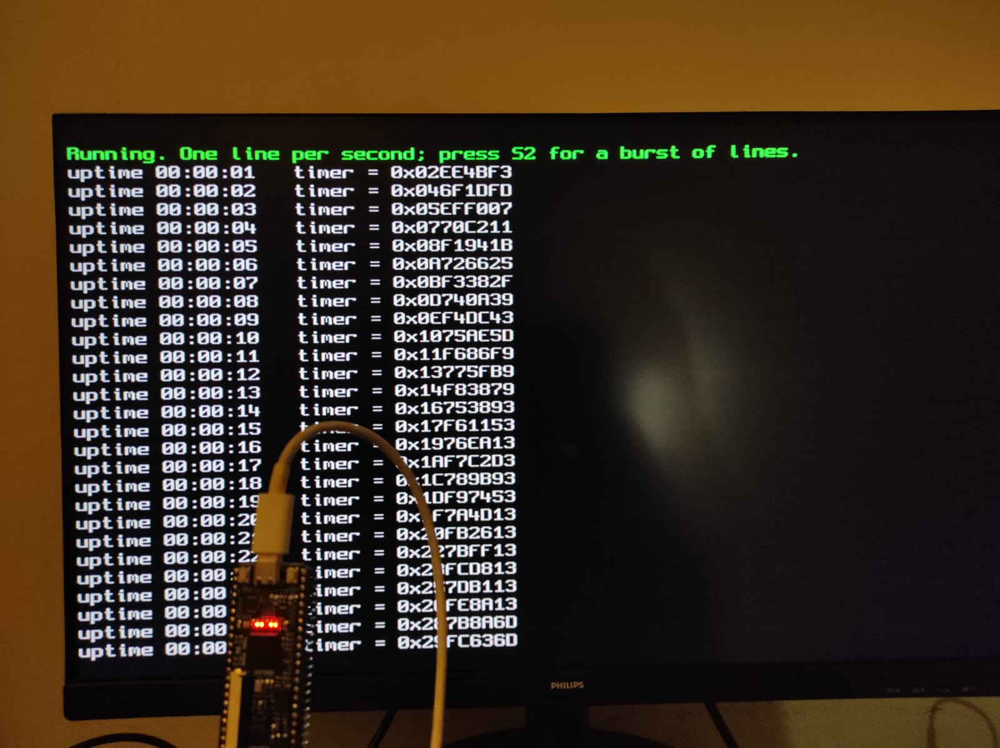
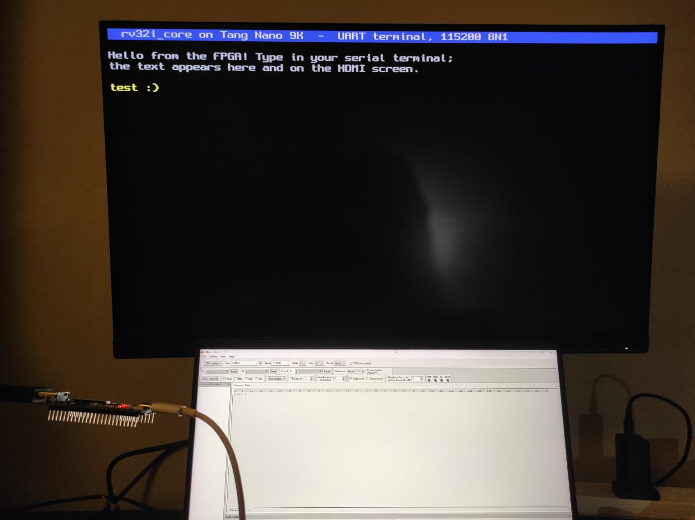

# tangnano9k-riscv-dvi

A RISC-V CPU written from scratch in Verilog, with an 80 x 30 color text
console on a monitor, a serial port and a bootloader - on a **Sipeed Tang
Nano 9K** FPGA board, built **step by step**: from a blinking LED to a CPU that
prints on the screen and loads its programs over USB.

Every step is a small project of its own that you can build, flash and check,
and adds one new idea to the previous ones. The [notes](notes/README.md)
explain what each step does, why, and what was measured.

## What's inside

- **`rv32i_core`** - a multi-cycle RISC-V CPU (RV32I base integer instructions),
  about 4 clock cycles per instruction, written to be read and understood
  ([notes/cpu.md](notes/cpu.md))
- **Video:** 640 x 480 at 60 Hz, **DVI signaling through the board's HDMI
  connector**, with an 80 x 30 text mode in 16 colors, hardware scrolling and a
  21-line scrollback ([notes/video.md](notes/video.md))
- **UART** over the board's USB connector, a **boot ROM** and a **serial
  bootloader**: new programs are uploaded over USB in seconds, without rebuilding
  the FPGA - with a small window or the command line
- **Software:** C programs compiled with GCC for the CPU, a console library,
  and a self-checking test of every instruction
- **Self-checking testbenches** for every step, run with iverilog

About the video output: the design sends plain DVI (TMDS video) through the
HDMI connector, which every HDMI monitor accepts. It does not implement HDMI
features such as audio or InfoFrames, and it is not an HDMI-certified product.
"HDMI" here only names the connector on the board.

## On the board

| | |
|---|---|
|  |  |
| **Step 2** - test pattern generated entirely in logic, 640 x 480 at 60 Hz | **Step 3** - 80 x 30 text mode: character set, 16-color palette, a frame counter written by hardware |
|  |  |
| **Step 6** - the CPU runs a C program and prints on the screen | **Step 7** - text typed in a serial terminal on the PC appears on the screen |

## The steps

| Step | Folder | New idea |
|---|---|---|
| 0 | [`00_blinky`](notes/steps/00_blinky.md) | Tool chain, pins, the 27 MHz clock, LEDs |
| 1 | [`01_pll`](notes/steps/01_pll.md) | PLL and clock divider, reset synchronizer |
| 2 | [`02_hdmi`](notes/steps/02_hdmi.md) | Video timing, TMDS encoding, serializers: a test pattern |
| 3 | [`03_text`](notes/steps/03_text.md) | Block RAM, font ROM, pipelining: 80 x 30 text mode |
| 4 | [`04_cpu_sim`](notes/steps/04_cpu_sim.md) | The RV32I CPU, the C compiler, testbenches (simulation only) |
| 5 | [`05_cpu_leds`](notes/steps/05_cpu_leds.md) | System-on-chip, memory-mapped IO, the CPU on the board |
| 6 | [`06_cpu_text`](notes/steps/06_cpu_text.md) | The CPU writes to the screen |
| 7 | [`07_uart`](notes/steps/07_uart.md) | Serial port: PC keyboard to the screen |
| 8 | [`08_bootloader`](notes/steps/08_bootloader.md) | Boot ROM + serial bootloader: upload programs over USB |

## Getting started

**You need:** a Tang Nano 9K, a monitor with an HDMI input and a cable, a USB-C
cable, and a PC with Windows 10/11 or Linux (x86-64).

1. Install Python, `make` and VS Code with the Lushay Code extension.
2. Run `python framework_initialise.py` in this folder: it downloads the exact
   tool versions the project was made with (RISC-V GCC, OSS CAD Suite) into
   `toolchain/`, sets up a Python virtual environment in `.venv/` and checks
   that everything works (on Linux: `python3`).
3. Tell Lushay Code where OSS CAD Suite is, open this folder in VS Code and
   build `00_blinky`.

**[SETUP.md](SETUP.md)** explains every step, how to map the tool paths, and
how to build without Lushay Code.

## Repository layout

```
00_blinky/ ... 08_bootloader/   one folder per step: top.v, pins (.cst), Lushay project, testbenches, .hex
lib/                            shared Verilog modules (CPU, SoC, video, UART, ...)
sw/                             CPU software (C, assembly) and its Makefile
tools/                          font/screen/program converters, upload tool and window
notes/                          documentation: architecture, CPU, video, gotchas, results, one page per step
framework_initialise.py         sets up the tools (see SETUP.md)
```

The `.hex` files (compiled programs, font, screen) are included, so the FPGA
designs can be built without the RISC-V compiler. `toolchain/`, `.venv/` and
`local_paths.mk` are created on your PC by `framework_initialise.py` and are
not part of the repository.

## Status and limitations

- All steps work on the board, except step 4, which is simulation only. All
  testbenches pass. Numbers are in [notes/results.md](notes/results.md).
- The CPU passes its own instruction tests and runs compiled C, but has not
  been checked against the official RISC-V compliance suite (`riscv-arch-test`).
- No interrupts, no CSRs, no multiply/divide instructions (GCC uses software
  routines) - see [notes/cpu.md](notes/cpu.md).
- The setup script and guide are tested on Windows. On Linux the setup script
  is tested on Debian 12; building, flashing and uploading from Linux are not
  tested yet.
- Known limitations of each step are listed on its page in `notes/steps/`.

## Credits and license

MIT License, see [LICENSE](LICENSE).

- Font: [Spleen](https://github.com/fcambus/spleen) 8x16 by Frederic Cambus,
  BSD 2-Clause (`tools/font/LICENSE-spleen`).
- Built with [OSS CAD Suite](https://github.com/YosysHQ/oss-cad-suite-build)
  (yosys, nextpnr, Project Apicula, Icarus Verilog, openFPGALoader),
  [xPack GNU RISC-V Embedded GCC](https://xpack-dev-tools.github.io/riscv-none-elf-gcc-xpack/)
  and [Lushay Code](https://marketplace.visualstudio.com/items?itemName=lushay-labs.lushay-code).
